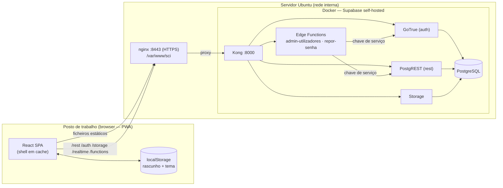
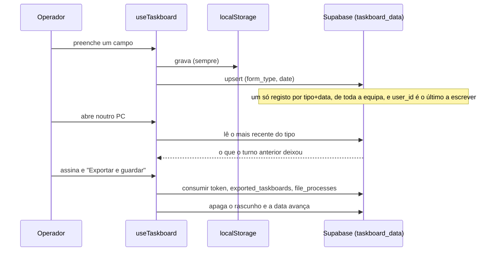
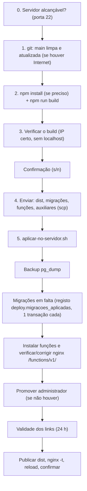

# TRD — Documento de Requisitos Técnicos

**Produto:** SCI — Sistema de Controlo Interno · **Versão:** 2.0 · **Data:** 2026-10-15

Complementa o [PRD](01-PRD.md). Descreve **como** o sistema está construído e operado.
Esquema detalhado da base de dados em [Backend Schema](05-Backend-Schema.md).

---

## 1. Visão geral da arquitetura



**Princípios**

1. **Frontend estático** — a app é um *build* estático servido pelo nginx; não há servidor de aplicação próprio.
2. **Supabase self-hosted como backend** — autenticação, API de dados, ficheiros e funções num só conjunto de contentores.
3. **Regras de negócio sensíveis no servidor** — funções SQL `SECURITY DEFINER` e Edge Functions; o browser nunca recebe a chave de serviço.
4. **Zero dependências externas em runtime** — fontes, ícones e bibliotecas empacotados; sem CDN.
5. **Rede isolada** — nada sai da rede do banco.

---

## 2. Stack tecnológico

### Frontend

| Camada | Tecnologia |
|---|---|
| Linguagem / UI | TypeScript 5.5 (estrito) · React 18.3 |
| Build | Vite 5.4 · `vite-plugin-pwa` (service worker, *precache* do shell) |
| Estilos | Tailwind CSS 3.4 · tokens CSS semânticos (`src/index.css`) · `tailwindcss-animate` |
| Componentes | shadcn/ui sobre Radix UI (checkbox, dialog, select, tabs, tooltip…) · `lucide-react` · `sonner` (toasts) |
| Estado / dados | `@tanstack/react-query` 5 · contextos (Auth, Tema, Sincronização, Estado do servidor) |
| Roteamento | `react-router-dom` 6 |
| Backend client | `@supabase/supabase-js` 2.49 |
| PDF | `jspdf` + `jspdf-autotable` (geração) · `pdf-lib` (anexar display de tapes) |
| Folhas de cálculo | `xlsx` (ler/escrever Excel) |
| Gráficos | `recharts` |
| Datas | `date-fns` |
| Tipo de letra | `@fontsource/inter` (self-hosted; sem Google Fonts) |

### Backend / Infra

| Componente | Tecnologia |
|---|---|
| Base de dados | PostgreSQL (contentor `supabase-db`) com `pgcrypto` |
| API de dados | PostgREST (`/rest/v1`) + funções RPC |
| Autenticação | GoTrue (`/auth/v1`); sessão JWT |
| Ficheiros | Supabase Storage (bucket privado `tapes-evidencia`) |
| Lógica de servidor | Supabase Edge Functions (Deno): `admin-utilizadores`, `repor-senha` |
| Proxy | Kong (:8000) atrás do nginx |
| Servidor web | nginx 1.24 (HTTPS :8443, certificado interno) |
| SO | Ubuntu Linux (`srvmonit1401`, 172.20.11.54) |

---

## 3. Estrutura do código

```
src/
  pages/            auth/ · sci/ (ficha, histórico, retornos, passagem, geradores, cartões, verificação)
                    easyvista/Estatisticas · Dashboard · Settings · Documentation
  components/       layout/ (sidebar, header, breadcrumbs, paleta, PageContainer…)
                    taskboard/ (secções da ficha, PIN, assinatura) · settings/ · alerts/ · charts/ · ui/ (shadcn)
  services/         acesso a dados: 1 ficheiro por área, devolve { data, error }
  hooks/            useTaskboard (estado da ficha) · useOperators · useAlerts · useSyncStatus · useServerStatus · use-theme
  lib/              lógica pura e testável: ps2, oic, nibBca, cobrancasSla, signatureHash,
                    fichaDoDia, taskboardProgress, colagemPs2, verificacaoSentido, utilizador, politicaSenha…
  utils/pdf/        um módulo por turno + tabela + tapes
  integrations/supabase/   client.ts e types.ts (tipos mantidos à mão)
supabase/
  migrations/       34 migrações idempotentes, por data
  functions/        admin-utilizadores/ · repor-senha/
production/
  deploy/           deploy-sci.ps1 · aplicar-no-servidor.sh · nginx-funcoes.sh · auth-validade-link.sh
  scripts/          criar-utilizador.sh (último recurso, no servidor)
docs/               esta documentação · contraste.md
```

**Convenções**

- **Serviços** nunca lançam: devolvem `{ data, error }`; a UI decide o toast.
- **Lógica pura** em `src/lib/` (sem React), para poder ser exercitada à parte.
- **Sensível = RPC.** Escritas que afetam integridade passam por funções do servidor, não por `insert`/`update` diretos.
- **Datas de negócio** são texto `AAAA-MM-DD` (a hora de Cabo Verde, sem conversão de fuso).

---

## 4. Autenticação e autorização

### 4.1 Contas

- Supabase Auth guarda a conta por **email**. O **utilizador** `nalves` corresponde a `nalves@bca.cv`; o ecrã
  de login completa o domínio (`src/lib/utilizador.ts`). Contas de outros domínios entram com o email completo.
- `user_metadata`: `name`, `utilizador`, `email_contacto`, `must_change_password`.
- **Sem auto-registo.** As contas criam-se pela função `admin-utilizadores` (ou, em último recurso, `criar-utilizador.sh`).

### 4.2 Papéis

- O papel vive em `operators.papel` (`operador` | `administrador`), ligado à conta por `operators.user_id`.
- `is_admin()` (SQL) e a função `admin-utilizadores` decidem **no servidor**; o browser só esconde controlos.
- `claim_operator()` não deixa uma conta reclamar um operador administrador.

### 4.3 Entrada e senhas

| Fluxo | Mecanismo |
|---|---|
| Login | `signInWithPassword` (utilizador → `…@bca.cv`) |
| Senha provisória | `must_change_password` → `PrivateRoute` redireciona para `/auth/definir-senha` |
| Link de definir senha | GoTrue `generate_link` (recovery), 24 h (`GOTRUE_MAILER_OTP_EXP=86400`), uso único; chega a `/reset-password` |
| Repor senha (admin) | Função `repor`: senha temporária + `must_change_password = true` |
| Esqueceu a senha | Função `repor-senha`: utilizador + PIN; `tentar_pin_reposicao()` (5 falhas/24 h) |

### 4.4 Assinatura (PIN)

1. `set_operator_pin` — PIN de 4 dígitos, guardado como **hash bcrypt** (`pgcrypto`).
2. `verify_operator_pin` — devolve um **token de uso único** (10 min); 5 falhas bloqueiam 5 min.
3. `consumir_token_assinatura` — gasto obrigatório antes de qualquer escrita assinada.
4. O PDF leva um **hash SHA-256** do conteúdo (data, tipo, turnos, tarefas, tabela, tapes) em `pdf_signature`.

---

## 5. Dados: leitura, escrita e segurança

### 5.1 Row Level Security

- **RLS ativa nas 18 tabelas** de `public`.
- Leitura aberta à equipa (`authenticated`) na maioria das tabelas, por decisão de negócio (a ficha é de todos).
- Tabelas com dados sensíveis (`operator_pins`, `signing_tokens`, `reposicao_tentativas`) **sem políticas**:
  só acessíveis por funções.
- Tabelas de integridade (`ps2_lotes`, `card_renewal_lotes`, `handover_*`, `reposicoes_senha`)
  **só com `SELECT`**; toda a escrita é por RPC (ou, nas reposições, pela função com chave de serviço).
  `card_renewal_cards` e `card_renewal_sessions` só têm `INSERT` (ingestão do ficheiro) e `SELECT`:
  a atribuição de cartões a lotes só existe através de `criar_lote_renovacao()`.

### 5.2 Funções do servidor (RPC)

Ver catálogo completo em [Backend Schema](05-Backend-Schema.md). Padrão: `SECURITY DEFINER`,
`SET search_path`, `REVOKE ... FROM public, anon`, `GRANT ... TO authenticated`.

### 5.3 Edge Functions

| Função | Chamada por | Autenticação | Faz |
|---|---|---|---|
| `admin-utilizadores` | Configurações → Utilizadores | JWT de um **administrador** (verificado no GoTrue + `operators`) | `listar` · `criar` · `novo-link` · `repor` · `papel` · `eliminar` |
| `repor-senha` | Login → "Esqueceu a senha?" | Nenhuma (quem esqueceu a senha não tem sessão) | Verifica PIN com limite e repõe a senha |

Ambas usam a **chave de serviço** (variável do runtime, nunca no browser), respondem a CORS e devolvem
`{ erro }` com código HTTP adequado.

### 5.4 Ficheiros

Bucket privado `tapes-evidencia` (display de tapes); acesso por `adicionar_evidencia_tapes` /
`remover_evidencia_tapes` e URLs assinadas.

---

## 6. Persistência da ficha (continuidade entre computadores)



- Chave natural: `UNIQUE (form_type, date)`; RLS de equipa.
- Falha do servidor: a app continua com o `localStorage` e recupera quando o servidor volta
  (`useServerStatus`, `SyncStatusBadge`).

---

## 7. Resiliência e PWA

- `vite-plugin-pwa` (`generateSW`) faz *precache* do shell (~26 entradas); **o Supabase nunca vem da cache**.
- Banner "sem ligação ao servidor" (ping periódico) e recuperação automática.
- Depois de cada deploy, abrir em janela privada (ou desregistar o *service worker*) para ver a versão nova.

---

## 8. Build, configuração e ambientes

| Variável | Onde | Para quê |
|---|---|---|
| `VITE_SUPABASE_URL` | `.env.production.local` (fora do git) | Endereço do servidor (`https://172.20.11.54:8443`). Sem ela, o *build* cai em `localhost:8000` |
| `VITE_SUPABASE_PUBLISHABLE_KEY` | `.env` / `.env.production.local` | Chave pública (anon) |
| `SUPABASE_SERVICE_ROLE_KEY` | Runtime das Edge Functions | Chave de serviço — **nunca** no frontend |
| `REPOR_SENHA_POR_PIN` | Contentor das funções | `false` desliga o "Esqueceu a senha?" por PIN |
| `SCI_URL_PUBLICA` | Contentor das funções (opcional) | Endereço da app para os links; por omissão usa o `Origin` |
| `GOTRUE_MAILER_OTP_EXP` | docker-compose (auth) | Validade dos links (segundos); 86400 = 24 h |
| `GOTRUE_URI_ALLOW_LIST` / `SITE_URL` | docker-compose (auth) | Onde o link pode redirecionar |

Verificações obrigatórias após *build* de produção: o bundle contém `172.20.11.54` e **não** contém `localhost:8000`.

---

## 9. Deploy e operação

### 9.1 Duas redes

O GitHub só se alcança na rede com Internet (WiFi); o servidor só na rede interna (cabo). O deploy aguenta
as duas: confirma o servidor antes de começar, tenta o `git pull` com limite de tempo e, sem Internet,
usa a versão local; só corre `npm install` se as dependências mudaram.

### 9.2 Pipeline (`deploy-producao.cmd` → `deploy-sci.ps1`)



- **Migrações**: o servidor guarda o que já aplicou em `deploy.migracoes_aplicadas` (schema não exposto pela API);
  cada migração corre numa transação com o seu registo; uma falha impede a publicação.
- **Auxiliares**: `nginx-funcoes.sh` (acrescenta `functions` à rota regex do vhost, com cópia de segurança e
  reversão) e `auth-validade-link.sh` (recria só o serviço `auth`).
- **Registo**: cada deploy deixa uma linha em `~/sci-versoes.log` (versão, build, resultado, backup).
- **Rollback**: o backup `~/backup_antes_*.sql` e as cópias dos ficheiros de configuração alterados (`*.antes-*`).

### 9.3 Backup

`pg_dump` antes de cada deploy. Backup periódico fora do deploy: a definir com a equipa de infraestrutura.

---

## 10. Qualidade e verificação

| Verificação | Como |
|---|---|
| Tipos | `npx tsc --noEmit -p tsconfig.app.json` (obrigatório antes de cada commit) |
| Build | `npm run build` |
| Contraste | `node scripts/contrast-audit.mjs` (WCAG AA, 3 temas) |
| Funções SQL | Testes em transação com `ROLLBACK` contra o Postgres local |
| Edge Functions | Testes unitários com Supabase simulado + integração contra o stack local |
| Interface | Verificação manual no browser contra o stack local |

**Lacuna assumida:** o repositório **não tem suite de testes automatizados**; os testes acima foram
executados à mão, fora do repositório. Ver [Plano de Implementação](06-Plano-de-Implementacao.md), §6.

---

## 11. Dívida técnica conhecida

| Item | Detalhe |
|---|---|
| Cobertura de testes parcial | Há testes para a lógica pura e as funções do servidor (`npm test`); faltam testes de ecrãs (React) e de SQL/RLS contra uma base real |
| `eslint` partido | A configuração não corre (incompatibilidade de versões); o `tsc` é a verificação efetiva |
| `crc_tratamentos` | Tabela e tipos da ferramenta CRC (removida) ainda existem; decidir se se apaga |
| `types.ts` à mão | Os tipos do Supabase são mantidos manualmente; gerar com a CLI quando houver acesso |
| Utilizador interno `@bca.cv` | Assume o domínio do banco; configurável em `src/lib/utilizador.ts` e na função |
| Dois ambientes de rede | O deploy depende de um PC com acesso por cabo |
