# App Flow — Fluxos da aplicação

**Produto:** SCI — Sistema de Controlo Interno · **Versão:** 2.0 · **Data:** 2026-10-15

Os diagramas usam Mermaid (renderizam no GitHub e em editores com suporte). Complementa o
[PRD](01-PRD.md) e o [UI/UX](03-UI-UX-Design.md).

---

## 1. Mapa de rotas

| Rota | Ecrã | Acesso |
|---|---|---|
| `/` | Redireciona para `/dashboard` | — |
| `/auth/login` | Login (+ "Esqueceu a senha?") | Público |
| `/reset-password` | Definir senha pelo link | Link de recuperação |
| `/auth/definir-senha` | Troca obrigatória da senha | Sessão com `must_change_password` |
| `/dashboard` | Início — "Hoje em resumo" | Autenticado |
| `/sci` → `/sci/procedimentos` | Entrada para as fichas | Autenticado |
| `/sci/taskboard` | Ficha — dia útil | Autenticado |
| `/sci/taskboard-dia-nao-util` | Ficha — dia não útil | Autenticado |
| `/sci/taskboard-final-mes-util` · `…-nao-util` | Redirecionam para as duas fichas (a folha de tapes vive dentro delas) | — |
| `/sci/historico-fichas` | Histórico de fichas | Autenticado |
| `/sci/retornos-cobrancas` | Retornos de cobranças | Autenticado |
| `/sci/passagem-turno` | Passagem de turno | Autenticado |
| `/sci/verificacao-ficheiros` | Verificar Débitos/Créditos | Autenticado |
| `/sci/ocorrencias` | Ficha de Comunicação/Ocorrências (avarias do dia, observações, PDF; histórico e pesquisa) | Autenticado |
| `/sci/soc` | Relatório SOC (análise do relatório de quarentena do Cisco ESA) | Autenticado |
| `/sci/geradores` | Geradores PS2 / OIC (`/sci/gerador-ps2` → separador PS2) | Autenticado |
| `/sci/renovacao-cartoes` | Renovação de cartões | Autenticado |
| `/easyvista` → `/easyvista/estatisticas` | Estatísticas de processamentos | Autenticado |
| `/settings` | Configurações (conta, PIN, utilizadores) | Autenticado (utilizadores: administrador) |
| `/registo-alteracoes` | Registo de alterações (quem alterou o quê e quando) | Administrador |
| `/docs` | Documentação | Autenticado |
| `*` | 404 | — |

---

## 2. Autenticação

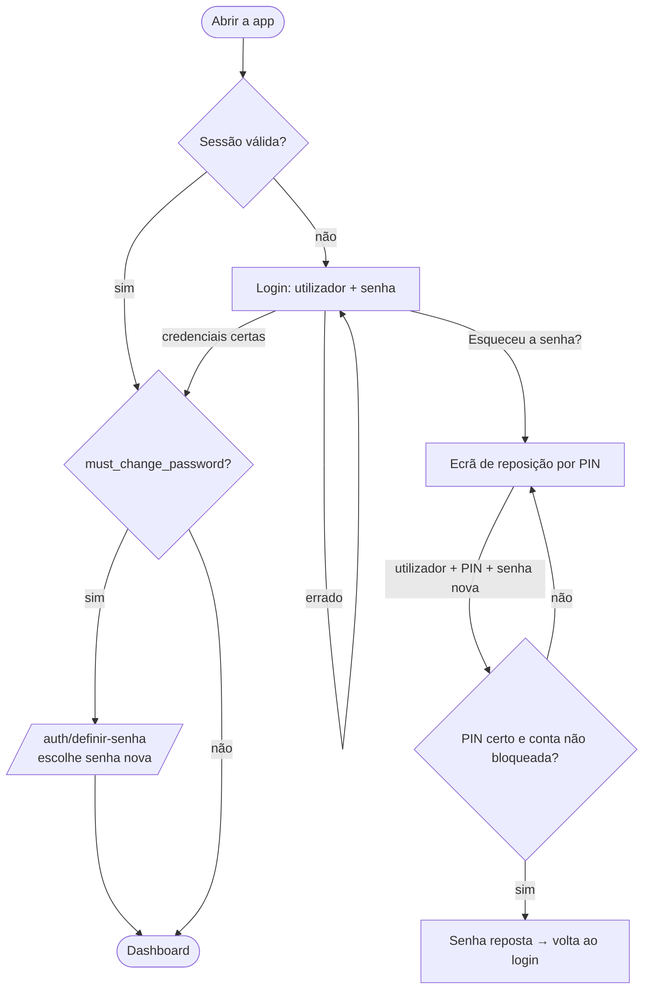

- A sessão persiste entre recargas (supabase-js).
- Todas as rotas internas passam por `PrivateRoute`: sem sessão → login; com `must_change_password` → definir senha.

---

## 3. Fluxo diário do operador

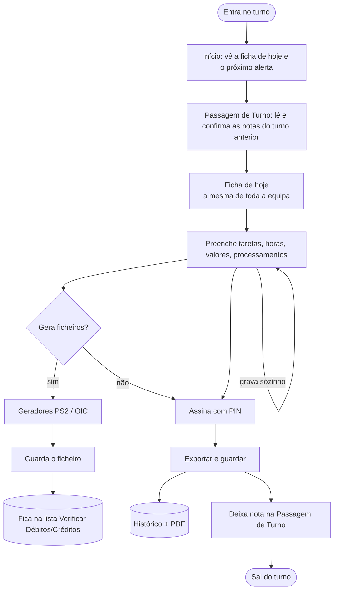

- Alertas de hora certa interrompem em qualquer ponto (§10).
- A ficha **não se perde** se o computador reiniciar: abre-se noutro posto e está igual.

---

## 4. Ciclo de vida da ficha

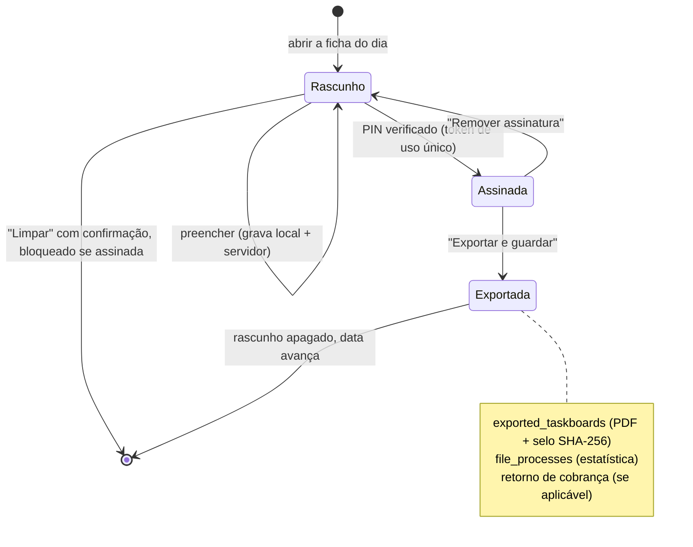

**"Exportar e guardar" valida, por esta ordem:** assinatura · operador/entrada/saída por turno · duplicados
de nº de operação · (com tapes) display anexado. Só depois: regista processamentos → gera PDF → arquiva →
apaga o rascunho → avança a data.

### 4.1 Verificação de tapes

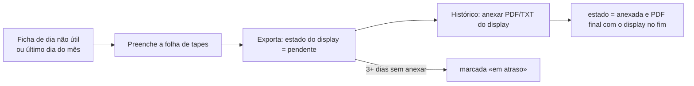

---

## 5. Retornos de cobranças

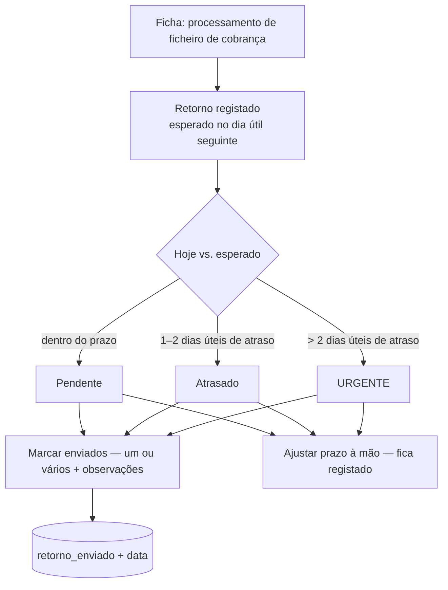

Contador de pendentes na barra lateral; feriados de Cabo Verde contam como não úteis.

---

## 6. Geradores PS2 / OIC

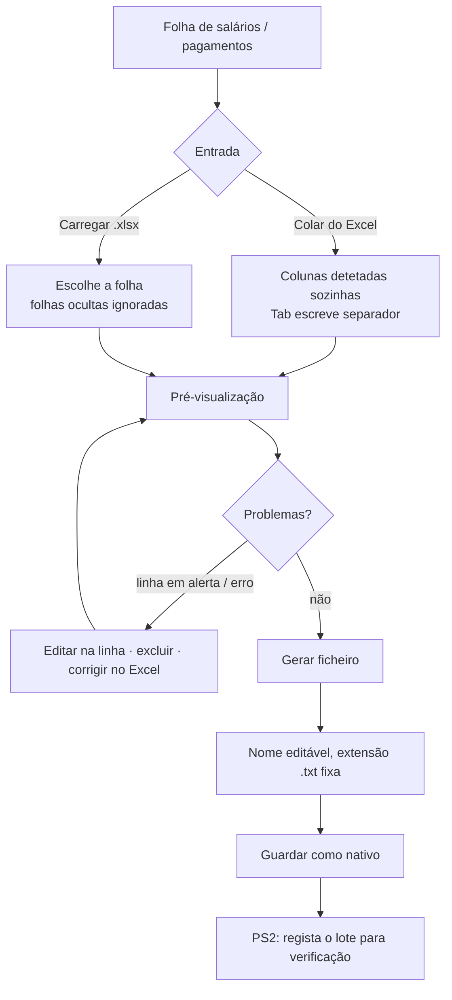

- **PS2** (contas BCA): conversão de contas para NIB e natureza; outros bancos ficam de fora.
- **OIC** (outros bancos): só NIB; NIBs do BCA ficam fora (vão pelo PS2); várias folhas juntas.
- Em ambos, a correção na linha só vale para o ficheiro gerado — o Excel de origem não muda.

### 6.1 Verificar Débitos/Créditos

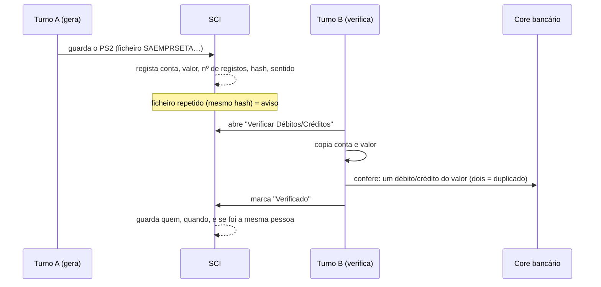

---

## 7. Renovação de cartões

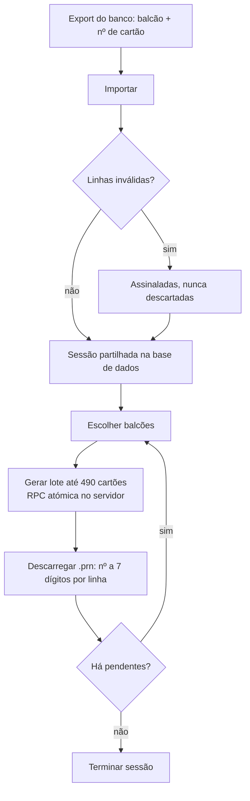

Garantia: um cartão não entra em dois lotes nem fica sem lote; duas pessoas a gerar em simultâneo não se
sobrepõem (bloqueio na sessão).

---

## 8. Passagem de turno

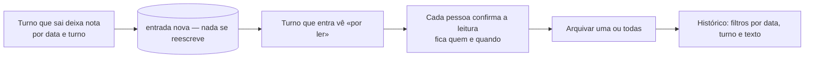

---

## 9. Administração de utilizadores

### 9.1 Criar um utilizador

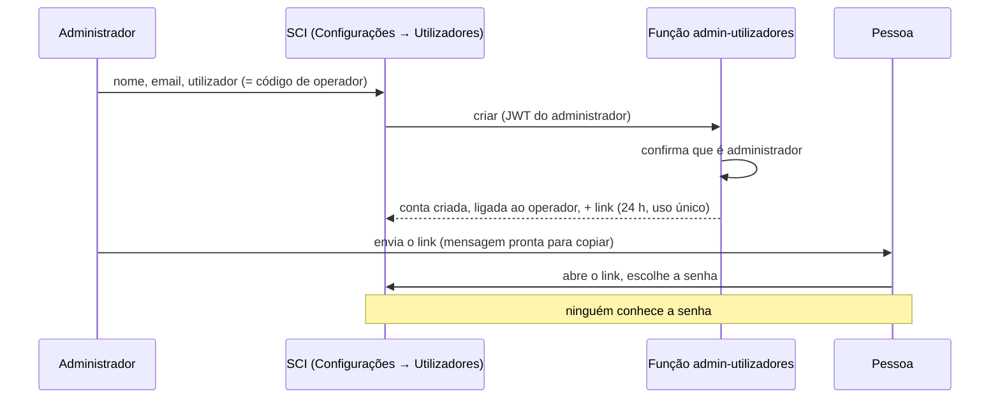

### 9.2 Senha esquecida — três caminhos

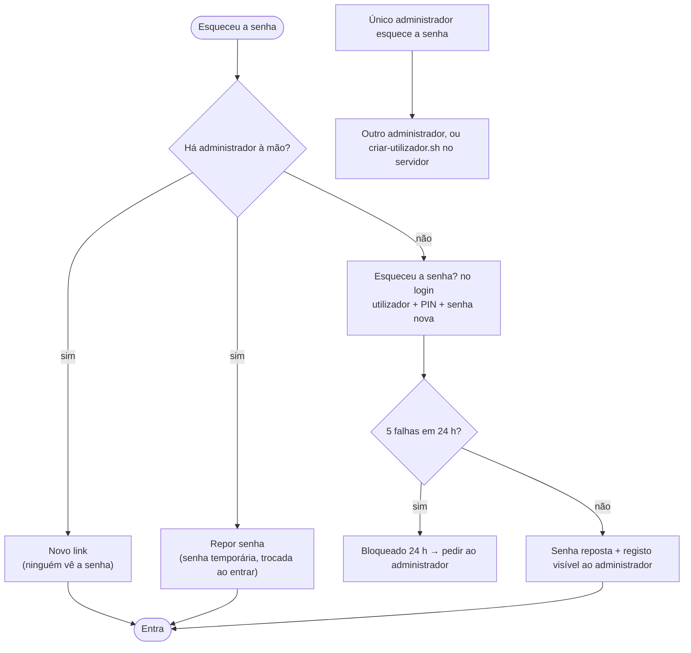

### 9.3 Tornar administrador / eliminar

- **Admin** (caixa): precisa de operador ligado; nunca deixa o sistema sem administrador.
- **Eliminar**: confirmação; a conta e o PIN desaparecem; o **operador, as fichas e o histórico ficam**.
  Pode criar-se de novo o mesmo utilizador (liga-se ao mesmo operador).

---

## 10. Alertas de hora certa

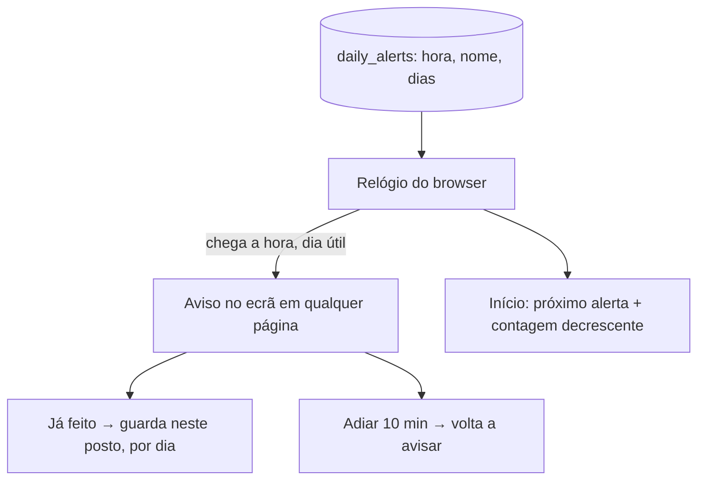

---

## 11. Estatísticas

`file_processes` (preenchida a partir da tabela de processamentos da ficha) → filtro de datas → barras por
mês e por tipo (salário, cobranças, compensação) → tabela detalhada → exportar XLSX / PDF.

---

## 12. Atualização do sistema (deploy)

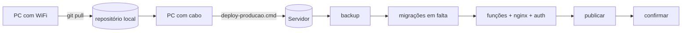

Detalhes técnicos em [TRD §9](02-TRD.md).
