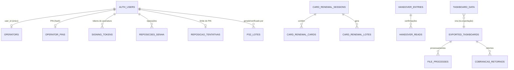

# Backend Schema

**Produto:** SCI — Sistema de Controlo Interno · **Versão:** 2.0 · **Data:** 2026-10-15

Esquema da base de dados (PostgreSQL / Supabase), funções, Edge Functions e armazenamento. Extraído do
estado real da base (migração `20261017100000_reposicao_senha`). Contexto em [TRD](02-TRD.md).

---

## 1. Visão geral

| | |
|---|---|
| Schemas usados | `public` (aplicação), `auth` (GoTrue), `storage`, `deploy` (registo de migrações, só no servidor) |
| Tabelas em `public` | 18 — todas com **RLS ativa** |
| Funções RPC | 28 (`SECURITY DEFINER` na quase totalidade) |
| Triggers | 9: 8 de `updated_at` + 1 de proteção de cartões |
| Migrações | 34, idempotentes, por ordem de data em `supabase/migrations/` |
| Extensões | `pgcrypto` (hash bcrypt do PIN) e as do Supabase padrão |

### Diagrama (relações principais)

> As ligações entre `taskboard_data` / `exported_taskboards` / `file_processes` / `cobrancas_retornos` são
> **lógicas** (feitas pela aplicação na exportação), não chaves estrangeiras.

---

## 2. Tabelas

### 2.1 Ficha de procedimentos

#### `taskboard_data` — rascunho da ficha (partilhado pela equipa)

| Coluna | Tipo | Notas |
|---|---|---|
| `id` | uuid PK | |
| `user_id` | text | **Último a escrever** (já não é o dono) |
| `form_type` | text | `dia-util` · `dia-nao-util` |
| `date` | text | `AAAA-MM-DD` (CHECK de formato) |
| `turn_data` | jsonb | Operador, entrada, saída, observações por turno |
| `tasks` | jsonb | Estado das tarefas por turno (checkbox, hora, valor) |
| `table_rows` | jsonb | Tabela de processamentos |
| `active_tab` | text | Turno ativo |
| `created_at`, `updated_at` | timestamptz | `updated_at` por trigger |

- **UNIQUE `(form_type, date)`** — uma ficha por tipo e data, para toda a equipa.
- **RLS:** `SELECT`/`DELETE`/`UPDATE` para a equipa; `INSERT` e `UPDATE (WITH CHECK)` exigem `auth.uid()::text = user_id`.
- O rascunho é apagado na exportação.

#### `exported_taskboards` — arquivo das fichas exportadas

| Coluna | Tipo | Notas |
|---|---|---|
| `id` | uuid PK | |
| `user_id` | text | Quem exportou |
| `form_type`, `date` | text | |
| `exported_at` | timestamptz | |
| `turn_data`, `tasks`, `table_rows` | jsonb | Instantâneo do conteúdo assinado |
| `pdf_signature` | jsonb | Dados da assinatura: signatário, hora e **selo SHA-256** do conteúdo |
| `file_name` | text | `FD DD.MM.AA.pdf` |
| `tapes_status` | text | `nao_aplicavel` · `pendente` · `anexada` (CHECK) |
| `tapes_evidencia` | jsonb | Lista de ficheiros anexados (display de tapes) |
| `tapes_anexada_at`, `tapes_anexada_by` | timestamptz, uuid | |

- **O conteúdo está coberto pelo hash**: não se reescreve (nem para corrigir códigos de operador).
- Índices: `exported_at`, `user_id`, parcial `tapes_status = 'pendente'`.
- **RLS:** `SELECT` para a equipa; `INSERT/UPDATE/DELETE` só do próprio (`auth.uid()::text = user_id`).

#### `file_processes` — registo de processamentos (estatísticas)

| Coluna | Tipo | Notas |
|---|---|---|
| `id` | uuid PK | |
| `date_registered`, `time_registered` | date, time | |
| `task` | text | Tarefa processada |
| `as400_name`, `operation_number` | text | Nº de operação (9 dígitos) |
| `executed_by` | text | **Código de operador** |
| `is_salary`, `tipo` | boolean, text | Categoria do processamento |
| `created_at` | timestamptz | |

- Vista `salary_processes` = linhas com `is_salary = true`.
- Índices: data, tipo, `is_salary`. **RLS:** equipa (leitura e escrita).

### 2.2 Prazos e comunicação entre turnos

#### `cobrancas_retornos`

`id` · `user_id` text · `data_aplicacao` date · `data_retorno_esperada` date · `ficheiro_nome` text ·
`retorno_enviado` bool · `data_retorno_enviado` date · `observacoes` text · `data_retorno_alterada_por` uuid ·
`data_retorno_alterada_em` timestamptz · `created_at`/`updated_at`.

- **UNIQUE `(ficheiro_nome, data_aplicacao)`**. **RLS:** `SELECT` equipa; `INSERT` do próprio; alterações por RPC.

#### `handover_entries` — notas de passagem de turno

`id` · `date` text · `turno` (`turno1|2|3`) · `texto` (1–4000) · `autor_user_id`, `autor_nome` ·
`created_at` · `arquivada_em`, `arquivada_por`, `arquivada_por_nome`.

#### `handover_reads` — confirmações de leitura

`id` · `entry_id` → `handover_entries` (CASCADE) · `user_id` · `user_nome` · `lida_em`.
**UNIQUE `(entry_id, user_id)`.**

#### `handover_notes` *(modelo anterior, mantido)*

Nota única por `(date, turno)` com leitura única. Substituída funcionalmente por `handover_entries`.

#### `daily_alerts` — alertas de hora certa

`id` · `alert_time` time · `alert_name` · `description` · `is_active` · `days_of_week` jsonb ·
`created_at`/`updated_at`. **RLS:** equipa (CRUD).

### 2.3 Pessoas, papéis e segurança

#### `operators`

| Coluna | Tipo | Notas |
|---|---|---|
| `id` | uuid PK | |
| `value` | text UNIQUE | **Código de operador** = utilizador (`nalves`, `elvisb`…); é o que fica nos dados |
| `nome` | text | |
| `ativo` | boolean | |
| `papel` | text | `operador` · `administrador` (CHECK) |
| `user_id` | uuid UNIQUE → `auth.users` (SET NULL) | Liga a conta ao operador |

- **RLS:** `SELECT` para a equipa; escrita só por `claim_operator()` e pela função de administração.
- Apagar a conta **não** apaga o operador (histórico preservado).

#### `operator_pins`

`user_id` PK → `auth.users` (CASCADE) · `pin_hash` (bcrypt) · `failed_attempts` · `locked_until` ·
`created_at`/`updated_at`. **RLS ativa, sem políticas** — só por funções.

#### `signing_tokens`

`token` uuid PK · `user_id` → `auth.users` (CASCADE) · `created_at` · `expires_at` (10 min) · `used_at`.
**RLS ativa, sem políticas.** Uso único; prova no servidor que o PIN foi verificado.

#### `reposicoes_senha`

`id` · `user_id` → `auth.users` (CASCADE) · `quando` · `metodo` (`pin` · `admin`) · `feito_por` →
`auth.users` (SET NULL). **RLS:** `SELECT` só para administradores (`is_admin()`). Escrita só pelas funções.

#### `reposicao_tentativas`

`user_id` PK (CASCADE) · `falhas` · `janela_inicio` · `bloqueado_ate`. Limite do "Esqueceu a senha?":
5 falhas em 24 h bloqueiam 24 h. **RLS ativa, sem políticas.**

### 2.4 Geradores e verificação

#### `ps2_lotes` — ficheiros PS2 guardados (para verificar)

| Coluna | Tipo | Notas |
|---|---|---|
| `id` | uuid PK | |
| `gerado_por`, `gerado_por_codigo` | uuid, text | Quem guardou |
| `nome_ficheiro` | text | Já traz a empresa (`SAEMPRSETA.txt`) |
| `empresa` | text | Derivada do nome, corrigível |
| `conta_empresa` | text | NIB de 21 dígitos |
| `tipo_operacao` | text | Ordenado, Fornecedores, … |
| `sentido` | text | `debito` · `credito` (CHECK) |
| `data_processamento` | date | |
| `total`, `n_registos` | numeric, int | |
| `hash_ficheiro` | text | SHA-256 do conteúdo (deteta ficheiro repetido) |
| `estado` | text | `por_verificar` · `verificado` · `problema` |
| `verificado_por`, `verificado_por_codigo`, `verificado_em` | | |
| `mesma_pessoa` | boolean | Verificado por quem guardou |
| `contagem`, `observacoes` | int, text | Usados pela via com PIN (substituída pelo "check") |

- **RLS:** só `SELECT` para a equipa; toda a escrita por RPC.

### 2.5 Renovação de cartões

| Tabela | Colunas principais | Regras |
|---|---|---|
| `card_renewal_sessions` | `id`, `user_id`, `nome`, `estado` (`em_curso`/`concluida`), `proximo_lote`, datas | RLS: `SELECT` equipa; `INSERT` do autor |
| `card_renewal_cards` | `id`, `session_id` (CASCADE), `numero_cartao` (CHECK 7 dígitos), `balcao`, `nome_titular`, `posicao`, `lote_numero` (NULL = pendente), `dados` jsonb | **UNIQUE `(session_id, numero_cartao)`**; trigger de proteção; `INSERT` só na sessão |
| `card_renewal_lotes` | `id`, `session_id` (CASCADE), `numero`, `balcoes[]`, `total_cartoes`, `ficheiro_nome`, `criado_por` | **UNIQUE `(session_id, numero)`**; só `SELECT` |

### 2.6 Legado

- **`crc_tratamentos`**: tabela da ferramenta CRC (removida da aplicação). Mantida; decidir se se apaga.

---

## 3. Funções do servidor (RPC)

Todas `SECURITY DEFINER` com `search_path` fixo; `REVOKE … FROM public, anon`; `GRANT … TO authenticated`
(exceto `tentar_pin_reposicao`, só `service_role`).

### Ficha e segurança

| Função | Faz |
|---|---|
| `operacoes_duplicadas_ficha(form_type, date, operacoes[])` | Nº de operação já registado noutras fichas |
| `operator_has_pin()` · `set_operator_pin(new)` · `change_operator_pin(cur, new)` | Gestão do PIN (bcrypt) |
| `verify_operator_pin(pin)` → uuid | Verifica o PIN; 5 falhas = bloqueio 5 min; devolve **token** (10 min) |
| `consumir_token_assinatura(token)` | Gasta o token; obrigatório antes de gravar a ficha assinada |
| `nome_operador_atual()` | Nome do operador da sessão |
| `is_admin()` | A sessão é de um administrador ativo? |
| `claim_operator(valor)` | Liga a conta a um operador livre; recusa operadores administradores |

### Retornos, tapes e passagem de turno

| Função | Faz |
|---|---|
| `marcar_retornos_enviados(ids[], observacoes)` | Marca vários retornos como enviados |
| `alterar_prazo_retorno(id, nova_data)` | Corrige o prazo (com registo de quem/quando) |
| `adicionar_evidencia_tapes(…)` · `remover_evidencia_tapes(…)` | Anexa/remove o display de tapes |
| `adicionar_entrada_passagem_turno(date, turno, texto)` | Nova nota |
| `confirmar_leitura_entrada_passagem_turno(entry)` | Regista a leitura |
| `arquivar_entradas_passagem_turno(ids[])` | Arquiva notas |
| `guardar_nota_passagem_turno` · `confirmar_leitura_passagem_turno` | Modelo anterior (`handover_notes`) |

### Cartões

| Função | Faz |
|---|---|
| `criar_lote_renovacao(sessão, balcões[], nome, limite=490)` | **Atómica**: bloqueia a sessão, escolhe cartões pendentes por balcão, atribui o lote, devolve os números |
| `pendentes_por_balcao_renovacao(sessão)` | Contagem de pendentes por balcão |
| `concluir_sessao_renovacao` · `reabrir_sessao_renovacao` · `descartar_sessao_renovacao` | Ciclo da sessão |

### PS2 / verificação

| Função | Faz |
|---|---|
| `registar_lote_ps2(…)` → jsonb | Regista o ficheiro guardado; devolve `{id, repetido, repetido_em}` |
| `editar_lote_ps2(id, empresa, sentido)` | Corrige empresa/sentido (sentido só antes de verificar) |
| `marcar_lote_ps2(id, verificado)` | Marca/desfaz a verificação (desfazer: quem verificou ou administrador) |
| `verificar_lote_ps2(id, token, contagem, obs)` | Variante com PIN (já não usada pela interface) |

### Reposição de senha

| Função | Faz |
|---|---|
| `tentar_pin_reposicao(user_id, pin)` → `ok`/`pin_errado`/`bloqueado`/`sem_pin` | Limite 5/24 h; **só `service_role`** (chamada pela Edge Function) |

### Utilitárias

`update_modified_column()` (trigger de `updated_at`) · `proteger_cartao_renovacao_batched()` (trigger).

---

## 4. Edge Functions (`/functions/v1/…`)

### `admin-utilizadores` — requer JWT de administrador

| `acao` | Corpo | Resultado |
|---|---|---|
| `listar` | — | `utilizadores[]` (conta, utilizador, email, nome, código, administrador, pendente, eliminável, última reposição, último acesso) + `operadoresSemConta[]` |
| `criar` | `email`, `nome`, `utilizador` | Conta (`<utilizador>@bca.cv`), operador ligado, **link** (24 h) |
| `novo-link` | `conta` | Novo link de definir senha (invalida o anterior) |
| `repor` | `conta` | **Senha temporária** (uma vez) + troca obrigatória; não na própria conta |
| `papel` | `conta`, `administrador` | Torna/retira administrador; nunca deixa zero |
| `eliminar` | `conta` | Elimina a conta; não a própria, nem a de administradores |

### `repor-senha` — sem sessão

`{ utilizador, pin, novaSenha }` → `{ ok: true }` ou `{ erro }` genérico. Limite por conta, resposta igual para
utilizador inexistente / sem PIN / PIN errado, registo em `reposicoes_senha`. Desligável com `REPOR_SENHA_POR_PIN=false`.

---

## 5. Armazenamento

| Bucket | Visibilidade | Uso |
|---|---|---|
| `tapes-evidencia` | Privado | Displays de tapes (PDF/TXT) anexados às fichas exportadas |

Acesso por RPC e URLs assinadas; nunca público.

---

## 6. Migrações

| Grupo | Migrações |
|---|---|
| Base | `20260212134723_full_schema` |
| Equipa e identidade | `team_visibility` · `operator_pins` · `operators` |
| Tapes | `tapes_evidencia` · `tapes_evidencia_rls_rpc` |
| Retornos | `cobrancas_retorno_data_alterada` · `cobrancas_rls_rpc` |
| CRC (legado) | `crc_tratamentos` |
| Passagem de turno | `handover_notes` · `handover_notes_rls_rpc` · `handover_historico` · `handover_arquivar` |
| Cartões | `card_renewal` · `_dados` · `_descartar` · `_terminar_reabrir` · `_descartar_sempre` · `_pendentes_agregado` · `renovacao_cartoes_audit_fixes` · `card_renewal_cards_insert_scope` |
| Endurecimento | `fechar_rls_publica` · `pin_bcrypt_cost` · `taskboard_date_check` · `pin_rate_limit_e_token_assinatura` · `operacoes_duplicadas_rpc` |
| Alertas | `daily_alerts_horarios` · `alerta_etr_1330` |
| Ficha da equipa | `taskboard_data_team_shared` |
| Administração | `claim_operator_nao_administrador` · `operador_elvisb` · `reposicao_senha` |
| Verificação de ficheiros | `ps2_lotes_verificacao` · `ps2_lotes_marcar_verificado` |

**Regras:** idempotentes (`IF NOT EXISTS`, `CREATE OR REPLACE`, `DROP POLICY IF EXISTS`); uma alteração por
ficheiro; o deploy aplica só as que faltam, cada uma com o seu registo numa transação.

---

## 7. Convenções

- Chaves `uuid` com `gen_random_uuid()`; datas de negócio em **texto `AAAA-MM-DD`**; `timestamptz` para eventos.
- `updated_at` mantido por trigger (`update_modified_column`).
- **Escritas que afetam integridade só por função** (lotes, verificação, cartões, passagem de turno, PIN).
- Funções com `SET search_path = public, extensions, pg_temp` quando usam `pgcrypto`.
- Códigos de operador são o identificador estável nos dados — **não se renomeiam em fichas assinadas**.

---

## 8. Pontos a rever (segurança e consistência)

| Ponto | Detalhe |
|---|---|
| Políticas com papel `public` | `exported_taskboards` e `cobrancas_retornos` têm `INSERT/UPDATE/DELETE` para `public` (inclui `anon`), protegidos só por `auth.uid() = user_id`. Funciona, mas convém passar para `authenticated`. |
| Fichas exportadas editáveis pelo autor | `UPDATE/DELETE` direto pelo dono permite alterar `turn_data`. O hash no PDF deteta-o, mas a base não impede. Considerar só RPC para anexar tapes. |
| Escrita aberta à equipa | `file_processes` e `daily_alerts` são editáveis por qualquer operador (decisão de negócio; auditar se mudar). |
| Nomes de políticas | Alguns com acentos corrompidos (`vis??veis`) por codificação; cosmético. |
| `handover_notes` | Modelo anterior ainda presente; remover quando não houver dados que interessem. |
| `crc_tratamentos` | Tabela da ferramenta removida. |
