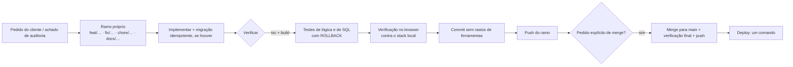

# Plano de Implementação

**Produto:** SCI — Sistema de Controlo Interno · **Versão:** 2.0 · **Data:** 2026-10-15

Este documento descreve **como o projeto foi (e é) conduzido**: o método, as fases já entregues, o estado
atual e o que falta. É o "plano que usámos", escrito depois do facto, e serve de guia para continuar.
Contexto em [PRD](01-PRD.md) e [TRD](02-TRD.md).

---

## 1. Método de trabalho

### 1.1 Ciclo de cada alteração

### 1.2 Regras

| Regra | Porquê |
|---|---|
| **Um ramo por alteração**; `main` só recebe por merge **pedido explicitamente** | `main` é o que vai para produção |
| **Verificar antes de commitar**: `tsc --noEmit` e `npm run build` | Sem erros de tipos nem de build |
| **Migrações idempotentes** e testadas duas vezes, com `ROLLBACK` | O servidor aplica-as automaticamente e pode repetir |
| **Escritas de integridade só por função do servidor** | O browser não é de confiança |
| **Nada de dados reais nos testes**; contas de teste criadas e removidas na própria verificação | Não deixar lixo na base |
| **Não reescrever dados assinados** | O selo de integridade cobre o conteúdo |
| **Mostrar o que se verificou e o que não** | Testar contra o servidor real é caro; dizê-lo evita falsas certezas |
| **Mensagens de commit descritivas, sem trailers de ferramentas** | Histórico limpo do projeto |

### 1.3 Definição de pronto

1. Compila (tipos + build) e a verificação aplicável passou (SQL, função, interface).
2. Documentação da app atualizada (`/docs` e README) quando muda comportamento visível.
3. Migração (se houver) idempotente, testada e com ordem correta.
4. Deploy não exige passos manuais novos — ou o passo está automatizado, ou documentado.
5. Dados sensíveis nunca em URLs, logs ou respostas.

---

## 2. Fases entregues

### Fase 0 — Base

Ficha digital com gravação automática, exportação em PDF fiel ao papel, histórico, retornos de cobranças,
registo de processamentos, estatísticas, alertas e *dashboard*; backend Supabase self-hosted; migração
`full_schema`. Os requisitos originais (v1.0) foram substituídos pelo PRD.

### Fase 1 — Revisão de UX e confiança (roadmap F1–F11)

| Sprint | Entregas | PRs |
|---|---|---|
| **0 — Quick wins** | Ajustes rápidos da revisão | #1 |
| **1 — Confiança e auditoria** | F1 vista de equipa · F3 gravação automática visível · **F2 assinatura por PIN** (hash bcrypt, selo SHA-256 no PDF) | #2–#3 |
| **2 — Base de interface** | F4 temas (claro/escuro/alto contraste) · F11 cabeçalho e breadcrumbs · F6 gráficos · F9 operadores como dados · refactor `useTaskboard` | #4–#8 |
| **3 — Prazos e checklist** | F7 SLA dos retornos em dias úteis · F8 progresso por turno, sem tarefas obrigatórias · F10 robô CRC (depois removido) | #11–#15 |

### Fase 2 — Fichas atualizadas e backlog do cliente

| Item | Resultado | PRs |
|---|---|---|
| Fichas atualizadas | Remoção das variantes de fim de mês (a **folha de tapes** passa a viver dentro das duas fichas), sincronização de tarefas, display de tapes anexado depois | #9, #10 |
| F12 DIS | **Removido** por decisão do cliente | #16 |
| F13 Passagem de turno | Notas por turno com confirmação de leitura | #17 |
| F14 Início | "Hoje em resumo": ficha de hoje, próximo alerta | #18 |
| F15 Calendário | **Removido** por decisão do cliente | #19 |
| F16 Resiliência | PWA (shell em cache), Inter self-hosted, banner de servidor | #20 |
| F17 Gerador PS2 | Porte fiel da macro Excel; colagem/ficheiro; NIB; modos de conta; excluir linhas; UX | #21–#28 |

### Fase 3 — Interface geral e documentação in-app

| Entrega | PRs |
|---|---|
| Tipografia (Inter), cores → tokens, largura consistente (`PageContainer`) | #29–#31 |
| Barra lateral nova, paleta de comandos (Ctrl+K), menu plano com grupos | #32, #35 |
| Cabeçalhos coerentes, estados vazios/carregamento, pt-PT por "tu" | #33, #34, #36, #37 |
| Auditoria de contraste WCAG AA (script + `docs/contraste.md`) | #39 |
| Documentação in-app, "Exportar e guardar", "Limpar" mais seguro | #40–#44 |

### Fase 4 — Auditorias de segurança e fiabilidade

Auditorias dirigidas por área (estatísticas, gerador PS2, segurança geral, renovação de cartões). Resultados:

- **Fechar RLS pública**; custo do bcrypt do PIN; **limite de tentativas** + **token de assinatura** de uso único;
- RPCs com RLS para cobranças, tapes e passagem de turno;
- Deteção de **duplicados de nº de operação** no servidor;
- Verificação de integridade das datas (`AAAA-MM-DD`);
- Correções de arredondamento e de parsing de valores nos geradores.

### Fase 5 — Renovação de cartões

Módulo novo: sessões partilhadas, **lotes de até 490** por balcões, `.prn` a 7 dígitos, atribuição **atómica**
no servidor (nenhum cartão duplicado ou perdido), descarte/reabertura/término de sessão, auditoria do módulo.

### Fase 6 — Geradores e ficheiros bancários

- **Gerador OIC** (macro `GerarFicheiroInterbancario`): linhas de 135 caracteres em ANSI; só NIB; NIBs do BCA
  fora sem bloquear; várias folhas juntas; sem acentos; montantes inteiros.
- **PS2**: escolha de folha por mês, "÷10" (só PS2), nome editável com extensão fixa, "Guardar como" nativo.
- **Edição na linha**, deteção de colunas também na colagem, Tab como separador.
- **Verificar Débitos/Créditos**: lote registado ao guardar; "Verificado" com quem e quando; aviso de ficheiro repetido.

### Fase 7 — Continuidade da equipa

A ficha deixa de ser "de quem a abriu" e passa a ser **única por tipo e data, para toda a equipa**
(`UNIQUE (form_type, date)`), igual em qualquer computador; o rascunho apaga-se ao exportar.

### Fase 8 — Operação e *deploy*

| Entrega | Detalhe |
|---|---|
| Deploy num comando | `deploy-producao.cmd` → `deploy-sci.ps1`: build, verificações, envio, migrações, publicação |
| Registo de migrações | `deploy.migracoes_aplicadas`; só as que faltam; 1 transação cada; backup antes |
| Duas redes | Confirma o servidor primeiro; `git pull` com limite de tempo; usa a versão local sem Internet |
| Funções e proxy | Instala as Edge Functions; corrige o nginx para `/functions/v1/` (com cópia e reversão) |
| Links 24 h | `GOTRUE_MAILER_OTP_EXP` via `auth-validade-link.sh` |
| Registo | `~/sci-versoes.log` |

### Fase 9 — Utilizadores e senhas

- Contas criadas pelo **administrador** na própria app; utilizador = código de operador (`nalves` → `nalves@bca.cv`).
- Senha **nunca conhecida** por quem cria: link de uso único; troca obrigatória no primeiro acesso.
- Administração: novo link, repor senha, eliminar, administrador sim/não (nunca zero).
- **Esqueceu a senha** sem email: PIN com limite 5/24 h, registo visível aos administradores.
- Correção de segurança: um operador administrador já não se reclama por uma conta normal.

### Fase 10 — Simplificação

Remoção do módulo CRC (serviço Python local nos PCs) e das páginas/rotas associadas.

---

## 3. Estado atual

| Área | Estado |
|---|---|
| Aplicação | Completa para o âmbito do PRD; em `main` |
| Base de dados | 34 migrações; em produção até à última aplicada pelo deploy |
| Deploy | Num comando; funções, nginx e validade dos links automatizados |
| Documentação | PRD, TRD, UI/UX, App Flow, Backend Schema e este plano em `docs/` |
| Testes | Verificações manuais e *scripts* ad hoc; **sem suite automatizada** |

---

## 4. Plano para a frente

Prioridades sugeridas (ordem de valor/risco).

### Curto prazo

| # | Item | Notas |
|---|---|---|
| 1 | **Segundo administrador** | Elimina o único ponto de falha da gestão de contas |
| 2 | **Exemplos reais do core** para a verificação de débitos/créditos | Hoje a verificação é manual (o "check"); com um exemplo de texto do core volta a ser possível contar movimentos |
| 3 | **Cabeçalhos de segurança no nginx** (CSP, HSTS) | Reforço do servidor |
| 4 | **Reset dos dados de teste** antes da produção real | Com backup; não tocar nas configurações (alertas, tabelas de natureza) |
| 5 | **Limpeza**: `jsonwebtoken`, `crc_tratamentos`, `handover_notes`, ESLint | Dívida listada no [TRD §11](02-TRD.md) |

### Médio prazo

| # | Item | Notas |
|---|---|---|
| 6 | **Testes automatizados** (Vitest para `src/lib/`; testes SQL; Playwright para 3–4 fluxos) | Ver §6 |
| 7 | **Autenticação por Active Directory (LDAPS)** | Serviço que valida no DC, lê grupos e cria a sessão; mantém `auth.uid()` e RLS; conta local de emergência. **Aguarda** respostas do administrador do domínio |
| 8 | **Endurecer políticas** com papel `public` e UPDATE direto de fichas exportadas | [Backend Schema §8](05-Backend-Schema.md) |
| 9 | **Backup periódico** fora do deploy e teste de restauro | A combinar com a infraestrutura |
| 10 | **Gerar `types.ts`** pela CLI do Supabase | Hoje é mantido à mão |

### Longo prazo / a decidir

| Item | Notas |
|---|---|
| **SQL Server** | Só se for **exigência** do banco. Implica API própria (PostgREST/GoTrue/Storage assentam em PostgreSQL), reescrever 54 políticas e 28 funções, ~6–10 semanas. Alternativa: exportar para SQL Server para relatórios |
| **Mensagem de início/fim do fecho** | Canal interno (email interno/Teams com saída permitida) ou botão que abre o WhatsApp com o texto pronto |
| **Verificação de salários a partir da carta** | Extração do PDF da empresa; depende de PDFs com texto |

---

## 5. Checklists

### Release (código)

- [ ] Ramo próprio, sem alterações por guardar
- [ ] `npx tsc --noEmit -p tsconfig.app.json` sem erros
- [ ] `npm run build` termina bem
- [ ] Migração idempotente, testada duas vezes com `ROLLBACK`
- [ ] Documentação in-app (`/docs`) e README atualizadas, se mudou comportamento
- [ ] Verificação no browser dos fluxos tocados; contas de teste removidas
- [ ] Commit descritivo; push do ramo; **merge só a pedido**

### Deploy

- [ ] `git pull` no PC com WiFi; `git log --oneline -1` mostra a versão esperada
- [ ] Cabo ligado; duplo-clique em `deploy-producao.cmd`
- [ ] Passo "2b": rota `/functions/v1/` OK; administrador definido
- [ ] Passo "2c": links a valer 24 h
- [ ] Janela privada: login, Configurações → Utilizadores, uma ficha
- [ ] Anotar o backup (`~/backup_antes_*.sql`) e a linha em `~/sci-versoes.log`

### Rollback

1. Voltar o `dist` anterior (cópia ou novo deploy da versão anterior).
2. Restaurar o backup da base **só se** a migração foi o problema (`~/backup_antes_*.sql`).
3. Repor o ficheiro de configuração alterado (`*.antes-funcoes.*`, `*.antes-otp.*`) e recarregar o serviço.

---

## 6. Qualidade e testes (proposta)

| Camada | O quê | Ferramenta |
|---|---|---|
| Lógica pura (`src/lib/`) | PS2, OIC, NIB, SLA, colagem, política de senhas, sentido, utilizador | Vitest |
| SQL | Funções críticas e RLS: lotes, tokens, PIN, reposição, passagem de turno | Testes em transação com `ROLLBACK` (já existem *scripts* ad hoc para migrar) |
| Edge Functions | `admin-utilizadores`, `repor-senha` com Supabase simulado + integração local | Vitest/Deno test |
| Interface | Ficha (preencher → assinar → exportar), geradores, administração | Playwright contra o stack local |
| Contraste | Já existe | `scripts/contrast-audit.mjs` |

Começar pelo que dói mais se partir: **assinatura**, **lotes de cartões**, **reposição de senha**.

---

## 7. Riscos do plano

| Risco | Mitigação |
|---|---|
| Alterar a ficha sem testes automáticos | Priorizar testes da §6 antes de grandes mudanças |
| Depender de um PC para deploy | Documentação do deploy; segundo PC com o mesmo acesso |
| AD atrasar | A app já usa `utilizador@bca.cv`; a integração encaixa sem mudar dados |
| Alterações de infra sem reversão | Todos os auxiliares fazem cópia e validam antes de aplicar |
| Dados de teste misturados com reais | Reset planeado e feito com backup |
